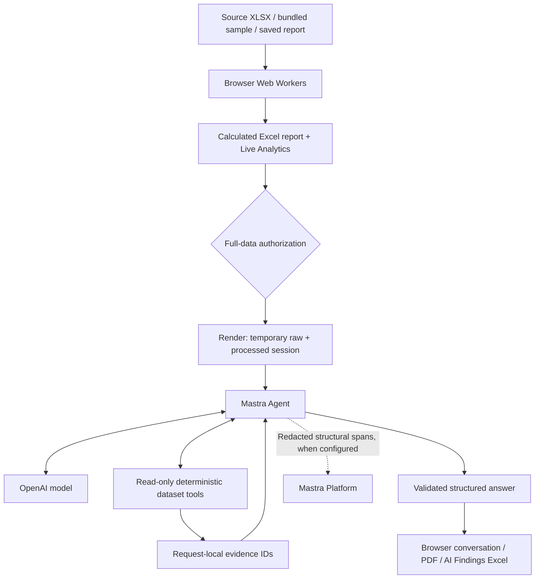

# How ExcelFlow AI Works — Technical Guide

Implementation walkthrough for developers and reviewers. Reviewed 18 October 2026. Hosted configuration and live-provider evidence must be checked separately.

## The complete architecture

A deterministic reporting application with a tool-using AI investigation layer.

Browser · GitHub Pages

Source upload / bundled sample / saved report

↓

Web Workers → deterministic processing → Excel + Live Analytics

Authorization boundary

User approves supplied raw workbook + processed dataset

↓

HTTPS → Render Node API → temporary session

Investigation loop · Render ↔ OpenAI

Mastra Agent → model selects a tool → server calculates → evidence returns to model → repeat

↓

Validated structured answer → browser → PDF / AI Findings Excel

Structural observability

Render agent runtime → redacted span exporter → Mastra Platform, when configured

Platform monitoring is separate from the agent runtime.

The frontend uses JavaScript modules, Vite and Web Workers. ExcelJS reads/writes workbooks, Chart.js draws browser charts, JSZip handles XLSX package modifications, and Zod validates API/tool/output structures. The Node backend is TypeScript, executed with tsx.

The AI layer starts after a report exists. Deterministic reporting does not need an AI key. This guide describes repository implementation and defaults reviewed on 18 October 2026; hosted settings and provider execution require separate runtime verification.

Source: [package.json](package.json), [src/app.js](src/app.js), [server/index.ts](server/index.ts), [server/agent.ts](server/agent.ts), [server/telemetry.ts](server/telemetry.ts)

## From XLSX to reliable report data

Worksheet selection and role mapping determine what the numbers mean.

Read and inspect

The browser accepts an unencrypted .xlsx workbook up to 20 MB. A ZIP guard checks structure and expanded size before ExcelJS parsing. Workbook loading and report generation run in a dedicated worker.

Review the structure

The user reviews the source sheet, detected header row, selected columns and suggested semantic roles. Saved Builder metadata can restore mappings. Labels stay recognizable in the source language; suggestions are editable.

Normalize and filter

Shared engine functions interpret numbers and dates using selected text formats and Excel date settings. Report periods have inclusive boundaries. Sorting, selected columns, sign and report choices determine the exported records.

Calculate and export

Positive amounts become inflows, negative amounts outflows, and zero/invalid amounts remain in Report Data where applicable. Invalid amounts do not enter numeric totals. Analysis generates KPIs, time summaries, group comparisons and native Excel charts. A hidden metadata sheet supports reopening saved reports.

Live Analytics has a separate computation worker and Chart.js views. Its temporary filters explore the dataset without rewriting the saved Excel export. Current-session source fields can exceed the columns retained in a downloaded report.

Implementation detail: Workbook formulas, macros and external links are not executed. The ZIP guard caps expanded contents at 150 MB and directory entries at 10,000. These are resource protections, not a guarantee that arbitrary input is harmless. Currency-separated analysis does not perform automatic exchange-rate conversion; raw flow-sheet sums retain original units.

Source: [src/worker.js](src/worker.js), [src/workbook-client.js](src/workbook-client.js), [src/workbook-guard.js](src/workbook-guard.js), [src/engine.js](src/engine.js), [src/source-recognition.js](src/source-recognition.js), [src/export.js](src/export.js), [src/charts.js](src/charts.js), [src/report-import.js](src/report-import.js), [src/live-worker.js](src/live-worker.js), [src/live-engine.js](src/live-engine.js)

## How the AI receives the dataset

Full supplied data is available to tools; model requests receive relevant results.

After authorization, the browser creates a POST /api/session payload containing consent:true, processed records, columns, role mappings, report period and text format settings. If supplied, the original workbook is sent as base64 with source mapping information. This is application data transfer to Render, not an OpenAI file upload.

The backend validates shapes and mappings and recomputes normalized amounts/dates from values rather than trusting browser-provided numeric fields. ExcelJS opens the guarded raw workbook; each usable worksheet becomes a table alongside the processed table.

Processed rows have IDs such as processed:r1. Raw evidence uses physical worksheet row IDs such as raw1:r8. Header/preamble rows remain accessible as structural data. The selected raw sheet can use supplied roles; other raw sheets require explicit column mappings for monetary/date calculations.

The complete supplied dataset resides in the temporary backend session. OpenAI receives conversation, tool definitions and relevant retrieved tool results during investigation. Tool pagination controls response size; it does not mean the agent can inspect only those first rows. A saved processed report alone cannot recreate an original source that was never supplied.

Implementation detail: Session tokens are random 32-byte values carried as Bearer authorization. Sessions live in process memory with a 20-minute inactivity TTL, checked by cleanup on requests and a minute timer. HTTP 410 triggers active-browser dataset reconnection and retry. Refresh, browser closure or server restart does not provide durable recovery; the user must retain exported work. This is not account-based tenant authentication.

Source: [src/ai-view.js](src/ai-view.js), [server/data.ts](server/data.ts), [server/index.ts](server/index.ts)

## What Mastra and OpenAI actually do

The language model chooses actions; application tools calculate the evidence.

Configure a session-scoped agent

server/agent.ts constructs a Mastra Agent with read-only tools closed over the current dataset. OPENAI_MODEL selects the model; the repository default is openai/gpt-5-mini. OPENAI_API_KEY remains on the backend.

Run the model / tool loop

The browser sends POST /api/ask with question, language, responseStyle and deep. agent.generate supplies instructions, recent history and tool definitions. The OpenAI model can request a tool; Mastra executes its registered server function, returns results and continues generation as needed.

Return structured interpretation

A Zod schema requires answer, findings, recommendations, limitations and followUps. Findings contain evidence references. The application adds tool audit entries, evidence, scope, generation time and requested language to the response.

Mastra is the agent framework and runtime orchestration layer; OpenAI supplies model inference. Deterministic JavaScript tools produce calculations. Mastra Platform is a separate observability destination and is not required to host this Render agent.

The instructions require catalog plus relevant calculation/evidence tools, source-aware investigation, currency separation and no invented numeric claims. Runtime checks require a non-catalog tool call and valid finding citations; they do not independently verify every instruction or every sentence.

For the general model → application tool → tool result → model pattern, see [OpenAI’s function calling documentation](https://developers.openai.com/api/docs/guides/function-calling). This project invokes Mastra’s generate interface rather than manually implementing that API loop.

Implementation detail: Current code uses maxSteps 16 for deep investigation and 10 otherwise, maxOutputTokens 5000, a 24-tool-call budget, and recent session history limited to 12 messages. These are ceilings, not expected counts or promises of completeness. Structured-output validation uses a strict error strategy; invalid responses are rejected. The model can be changed through server configuration; the deployed value is not disclosed by this guide.

Source: [server/agent.ts](server/agent.ts), [server/tools.ts](server/tools.ts), [src/ai-view.js](src/ai-view.js)

## The nine investigation tools

Each tool is read-only and restricted to the current session.

| Tool | What it contributes |
| --- | --- |
| catalog | Tables, labels, mappings, counts and source availability. |
| overview | Currency-separated KPIs, time summaries, quality and extremes. |
| records | Filtered and sorted pages with stable row IDs. |
| cell | Original cell text, including structural rows and long values. |
| aggregate | Full matching-data groups, date buckets, totals, shares and extremes. |
| compare | Two inclusive ranges with currency-separated changes. |
| anomalies | Median, quartiles, 1.5×IQR fences and flagged row evidence. |
| quality | Missing/invalid amounts, date problems and duplicate-looking rows. |
| reconcile | Source/report coverage and selection boundaries. |

Example: “Which day had the highest EUR inflow?” can use catalog to identify Date/Amount/Currency and aggregate grouped by day, sorted by totalIn. “What was the smallest individual receipt?” instead needs positive records sorted by amount. This is an illustrative valid route; the model’s actual tool sequence can differ.

Aggregate calculations cover the full matching dataset before pagination. records pages up to 50 rows; cell returns text in 4,000-character chunks. Oversized results tell the agent to narrow filters or retrieve another page. IQR flags are heuristics, not proof of fraud or error.

Source: [server/tools.ts](server/tools.ts), [server/data.ts](server/data.ts), [src/analysis.js](src/analysis.js)

## How an answer can be checked

Evidence IDs identify a calculation in that investigation request.

The tool wrapper assigns IDs such as e1 and e2 and stores {tool, query, result}. Tool output returns its evidenceId to the model. Audit entries record tool name and duration. Each finding must cite at least one ID present in that request’s evidence map, or the response is rejected.

In the UI, “Inspect evidence and tool calculations” exposes the returned evidence; findings, recommendations and limitations are shown separately. IDs restart for each request, so an e1 in one answer is not the same evidence as e1 in another.

Citation validation establishes that a referenced result exists. It does not prove that the model interpreted it correctly, every numeric sentence is supported, a period is complete, or an accounting conclusion is true. Review the query, currency, row scope and calculation alongside the prose.

Deep investigation asks for data quality, trends, concentration, unusual transactions and source/report coverage. Missing context must be stated. Cash-flow totals alone cannot establish accounting profit, causation or business completeness.

Source: [server/tools.ts](server/tools.ts), [server/agent.ts](server/agent.ts), [src/ai-view.js](src/ai-view.js)

## Languages, conversation and exports

Calculated reports and AI interpretation stay distinguishable.

The client sends the selected answer language with each question. Ten presets and a custom language name are supported; original source labels remain visible. The agent is instructed to answer in that language/script and clarify ambiguous labels. This is model interpretation, not a guaranteed translation service; quality varies by language and source context.

Answers append to the conversation. Progress text and elapsed time indicate waiting; Cancel aborts the browser request, and the backend aborts generation when the response connection closes. The request returns a complete JSON answer, not streamed tokens. Brief/paragraph requests keep supporting evidence expandable.

Individual and combined answer PDFs reuse stored response data. The calculated English business-overview PDF uses the processed report before temporary Live Analytics filters and requires no AI question. Browser print output supports multilingual scripts; the user chooses Save as PDF. No export makes a new AI inference call.

The updated Excel adds an AI Findings worksheet with question, language, answer, findings and serialized evidence. JSZip patches a new OOXML sheet and package relationships rather than round-tripping all original sheets through ExcelJS. This preserves existing worksheet/chart parts. The ordinary report download is a separate export without newly generated AI findings.

Implementation detail: Cell content in the AI Findings export is limited to Excel’s 32,767-character cell length, and the exporter rejects a workbook that already contains an AI Findings sheet. Use the original report for a fresh updated copy. PDF layout depends on the browser, fonts and print settings.

Source: [src/ai-languages.js](src/ai-languages.js), [src/ai-view.js](src/ai-view.js), [src/ai-pdf.js](src/ai-pdf.js), [src/ai-export.js](src/ai-export.js)

## GitHub Pages, Render and configuration

A static frontend and a separate Node API have different configuration needs.

Build the frontend

.github/workflows/verify.yml runs foundation tests, backend type checking and AI tests, then builds Vite’s dist output and publishes it to GitHub Pages on eligible runs. The repository Actions variable VITE_AI_URL supplies the public HTTPS backend address at build time.

Run the API on Render

render.yaml defines a Node web service named excelflow-ai-api, free plan, Frankfurt region. Its build command is npm ci && npm run check:server && npm run test:ai. Start command: npm run start:server. The server listens on 0.0.0.0 using PORT.

Configure server secrets

OPENAI_API_KEY is a backend-only secret. OPENAI_MODEL chooses inference. ALLOWED_ORIGINS controls browser CORS. AI_MEMORY_MB and AI_DAILY_REQUESTS bound demo capacity. MASTRA_PLATFORM_ACCESS_TOKEN and MASTRA_PROJECT_ID enable the structural trace exporter when both are configured.

Check runtime readiness

GET /api/health reports readiness, whether a key is present and session duration. configured:true checks key presence only; it does not verify a valid OpenAI credential, model permission or trace delivery. Test an authorized investigation separately.

Never put API keys or Platform access tokens in VITE_ variables, frontend bundles, screenshots or commits. Frontend URL changes need a rebuild. Backend free-host cold starts can add delay; OpenAI API inference has its own provider usage costs. No pricing or free-tier availability guarantee is made here.

Implementation detail: Local developer flow: Node 24 → npm ci → copy .env.example to ignored .env → set backend secrets privately → npm run dev:server and npm run dev in separate terminals. Public APIs: GET /api/health; POST /api/session; POST /api/ask with Bearer token; DELETE /api/session. The public URL is configuration, not authentication. CORS controls browser access, not all possible clients.

Source: [.github/workflows/verify.yml](.github/workflows/verify.yml), [render.yaml](render.yaml), [.env.example](.env.example), [AI_SETUP.md](AI_SETUP.md), [server/index.ts](server/index.ts)

## Privacy, session isolation and traces

Application evidence and Mastra Platform traces serve different purposes.

Local reports and Live Analytics operate in the browser. AI authorization sends the complete supplied raw workbook and processed dataset to the temporary backend. Relevant tool results go to OpenAI. The read-only tools have no configured web search, filesystem or external action capability.

Agent instructions treat spreadsheet cells and user requests as untrusted and disallow secret disclosure, cross-session requests and external actions. Tools are scoped by their session closure; an unguessable bearer token selects a dataset. Instructions are a defense, not a guarantee against every prompt attack.

When both Platform environment variables are configured, the Mastra runtime attaches an observability exporter. safeSpan whitelists span identity/type/timing fields, fixes the agent identity and strips attributes, metadata and content-bearing payloads. Log, metric, score and feedback event exports are disabled. Agent tracing hides inputs and outputs; the runtime uses a no-op logger.

A PDF with evidence IDs proves what that export contains. It does not independently prove provider execution or delivery to Mastra Platform. Inspect a real run’s API response and tool audit, then correlate its timing with agent/model/tool spans in the configured Platform project. Redacted structural traces intentionally do not reproduce financial contents.

Implementation detail: These controls describe this application’s logging and export path. They are not a claim about all hosting/provider retention policies. The demo uses process-local session/rate/request limits; it has no durable account database, billing system or distributed abuse controls. A restart clears sessions and process-local budgets.

Source: [server/telemetry.ts](server/telemetry.ts), [server/agent.ts](server/agent.ts), [server/index.ts](server/index.ts), [src/ai-view.js](src/ai-view.js)

## A reproducible reviewer walkthrough

Separate source inspection, automated checks and live-provider evidence.

Inspect the implementation

Follow the source links in each chapter. Confirm the registered Mastra tools, agent.generate call, OpenAI model configuration, evidence validation and trace formatter rather than relying on a screenshot.

Run deterministic checks

npm test covers the reporting foundation. npm run test:ai covers backend calculations, schemas, sessions and related integration behavior. npm run check:server and npm run build check TypeScript and browser compilation. Browser suites cover reporting, Live Analytics, Builder, guides and AI UI/export flows.

Reproduce the fictional case

Use Try with Sample Data, select Movimientos, header row 1, and review Fecha→Date, Importe→Amount and Divisa→Currency. Use All Records. public/examples/expected-results.json specifies 60 records, one invalid amount, EUR inflows 6,806, outflows −1,965 and net 4,841; USD outflow/net −79. Keep currencies separate.

Verify a real AI run

Authorize the sample, run deep investigation and ask a question about a date or group. Inspect evidence and tool calculations; reconcile figures against deterministic results. Check the updated Excel’s AI Findings and original charts. If Platform export is configured, inspect matching run spans separately.

Controlled browser fixtures test UI/API behavior, not OpenAI reasoning quality. Passing local tests does not prove a deployed credential works or that traces arrived. A reviewer can repeat real-provider checks with the public fictional sample without exposing private records. No competition outcome or blanket accuracy claim follows from these tests.

Source: [tests](tests), [public/examples/expected-results.json](public/examples/expected-results.json), [tests/ai-browser.mjs](tests/ai-browser.mjs), [tests/sample-browser.mjs](tests/sample-browser.mjs), [TEST_REPORT.md](TEST_REPORT.md), [AI_SETUP.md](AI_SETUP.md)

## Boundaries and technical tradeoffs

Full-data investigation is bounded by runtime resources and available context.

Repository defaults allow up to eight in-memory sessions, two concurrent investigations and a 20-minute inactivity TTL. AI_MEMORY_MB defaults to 96 MB with an individual dataset capped at half that budget. API session bodies are limited to 40 MB; raw XLSX is limited to 20 MB. Raw parsing also bounds cells, rows and columns.

Questions are limited to 4,000 characters. Request quotas include 30 requests/minute per resolved IP and six asks/minute per token; AI_DAILY_REQUESTS defaults to 100 per process/day. Generation is aborted after 110 seconds. Tool output and call budgets can require narrower follow-ups or more pages. Actual hosted settings may differ.

The analyst cannot know records that were never supplied, assume missing costs, infer causation from a pattern or silently combine currencies. Reconciliation counts do not prove missing transactions. Duplicate-looking rows are flagged, not automatically deleted.

This design favors transparent, temporary, tool-based spreadsheet investigation. Large workbooks, simultaneous public traffic, provider errors and multilingual ambiguity remain practical constraints. Use calculated evidence, clearly stated scope and human review when interpreting business decisions.

Source: [server/index.ts](server/index.ts), [server/data.ts](server/data.ts), [server/tools.ts](server/tools.ts), [server/agent.ts](server/agent.ts)
